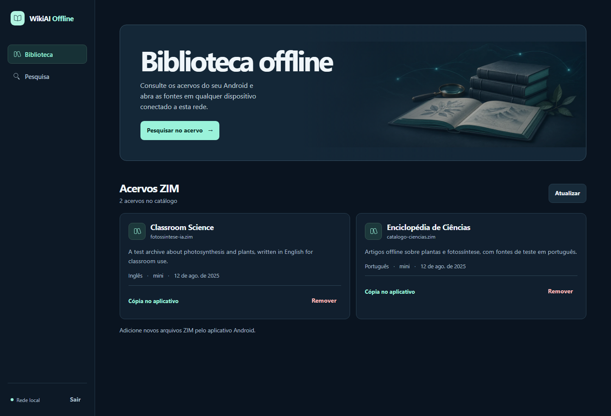
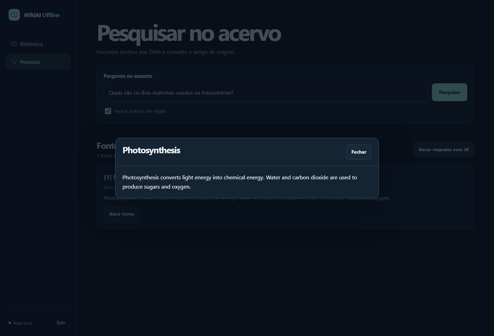
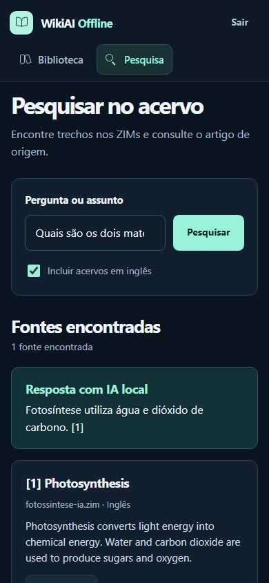
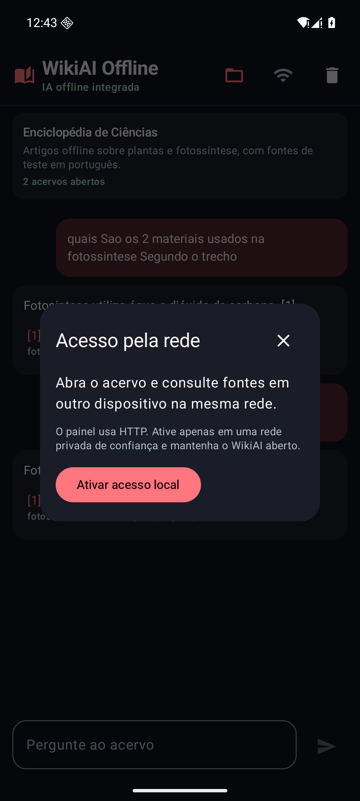
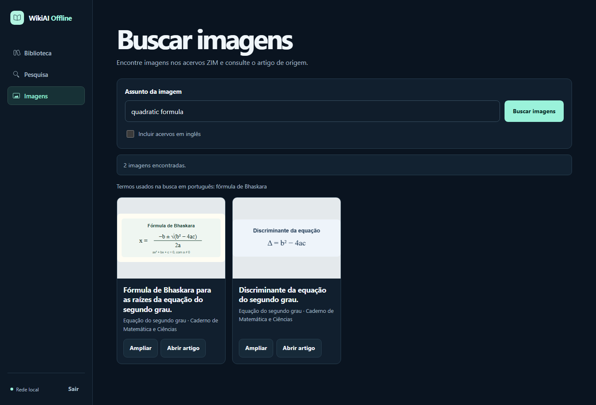
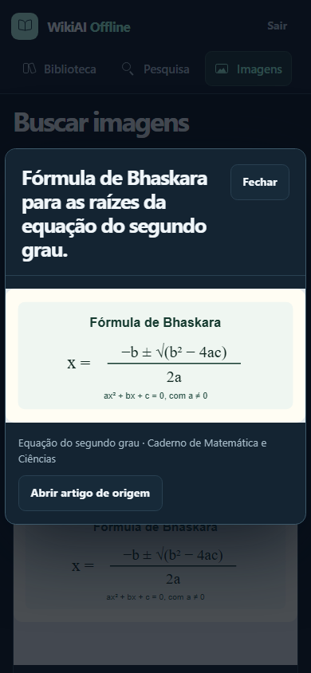
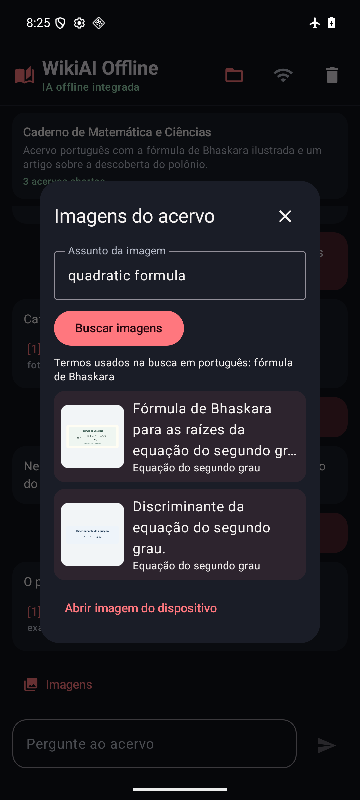

<div align="center">
  <p><strong>Consulte acervos ZIM em português e inglês e obtenha respostas com inteligência artificial executada diretamente no Android.</strong></p>
  <p>
    
    
    
    
    
    
  </p>
  <p>
    <a href="https://github.com/odevfigueiredo/WikiAIOffline/actions/workflows/build-apk.yml">APK de teste</a> ·
    <a href="./INSTRUCOES_PTBR.txt">Guia rápido</a> ·
    <a href="#-galeria">Galeria</a> ·
    <a href="./docs/ACESSO_LOCAL.md">Pesquisa e validação</a>
  </p>
</div>

---

## 📖 Sobre

O **WikiAI Offline** é um aplicativo Android para pesquisar conteúdos de arquivos **ZIM** sem depender de uma conexão com a internet. Ele combina a consulta a acervos locais em português e inglês com um modelo de linguagem executado no próprio dispositivo.

O APK para **ARM64** inclui o modelo multilíngue **LFM2.5 350M**. Instale o aplicativo, abra um arquivo ZIM e pesquise. O modelo já está pronto para uso e é carregado na primeira consulta que precisa de geração.

O mesmo acervo e a IA ficam disponíveis em um painel para outros dispositivos na rede local. A versão **0.8.0** acrescenta busca de imagens nos ZIMs e procura automaticamente por termos em português ao consultar em inglês.

> A utilização dos acervos e do modelo é local. A obtenção inicial dos arquivos ZIM e das dependências de compilação pode exigir acesso à internet.

---

## ✨ Funcionalidades

- **Leitura de acervos ZIM** com título e descrição quando esses dados estão no arquivo.
- **Busca local** por títulos e palavras-chave. A busca por título continua disponível em acervos sem índice de texto completo.
- **IA integrada:** geração de respostas curtas usando o modelo **LFM2.5 350M** incluído no APK.
- **Carregamento sob demanda:** o modelo é carregado na primeira consulta que precisa de geração.
- **Pesquisa bilíngue:** consultas em inglês também usam termos em português. O dicionário inglês–português já vem no APK. A busca em português pode recorrer a termos em inglês conforme a configuração e os acervos abertos.
- **Busca de imagens:** localize ilustrações e fórmulas por título, legenda ou assunto do artigo e amplie o resultado. A busca depende das imagens incluídas no próprio ZIM.
- **Visualização de arquivos locais:** abra uma imagem do aparelho pelo seletor do Android.
- **Fontes consultáveis** com trechos exibidos antes da síntese e acesso ao texto original por referências numeradas.
- **Preservação dos resultados:** os trechos continuam disponíveis caso a geração seja interrompida, ultrapasse o tempo ou produza referências inválidas.
- **Catálogo e histórico locais:** os dados de uso permanecem armazenados no dispositivo.
- **Modelos personalizados:** gerenciamento de modelo já instalado em **Acervo offline → Opções avançadas**.
- **Tratamento de acesso a arquivos:** cópia automática do ZIM, com progresso, quando o Android não permite manter o acesso direto ao arquivo selecionado.
- **Painel web opcional:** pareamento por código, consulta ao catálogo, busca, síntese local, leitura das fontes e remoção de um acervo do catálogo com confirmação. O painel se adapta a computadores e celulares.

---

## 🧱 Tecnologias

<div align="center">
  
  
  
  
  
  
  
</div>

---

## 📱 Como começar

### 1. Instale o aplicativo

Instale o APK em um smartphone ou tablet **ARM64** com **Android 13 ou superior**. O pacote `offline` de teste tem cerca de **308 MB** e já incorpora o modelo de linguagem para a geração local.

Quando o build da versão 0.8.0 estiver disponível no GitHub Actions, siga os passos abaixo. A seção **Compilação** mostra como gerar o APK localmente.

1. Entre na sua conta do GitHub e abra uma execução da versão 0.8.0 concluída com sucesso. [GitHub Actions do WikiAI Offline](https://github.com/odevfigueiredo/WikiAIOffline/actions/workflows/build-apk.yml)
2. Em **Artifacts**, baixe `wikiai-offline-v0.8.0-arm64-debug-apk` e extraia o APK.
3. Transfira o APK para o aparelho e instale-o.

O GitHub Actions mantém esse artefato por **14 dias**. A seção de compilação explica como gerar uma cópia local.

### 2. Adicione uma biblioteca ZIM

1. Transfira um arquivo `.zim` para o aparelho ou obtenha um acervo no [catálogo do Kiwix](https://library.kiwix.org/).
2. No WikiAI Offline, toque em **Abrir arquivo ZIM**.
3. Selecione o arquivo pelo seletor do Android.
4. Confira o título e a descrição quando estiverem no ZIM. Se faltar o título, o aplicativo exibe o nome do arquivo. Quando o Android exigir uma cópia, o progresso aparece na interface. A cópia ocupa espaço adicional no aparelho.

> Arquivos disponíveis apenas na área privada de outro aplicativo precisam ser disponibilizados pelo seletor de arquivos do Android antes de serem abertos no WikiAI Offline.

### 3. Pesquise e consulte as fontes

1. Digite uma pergunta em português ou inglês sobre o conteúdo do acervo. Por exemplo, `quadratic formula` também pesquisa por **fórmula de Bhaskara** em acervos em português.
2. Confira os trechos exibidos conforme a busca os encontra.
3. Quando necessário, aguarde o carregamento do modelo para gerar uma resposta curta a partir do trecho mais relevante.
4. Toque na referência numerada para consultar o texto original.

A marcação **[1]** identifica a fonte do trecho enviado à IA. Os demais resultados permanecem disponíveis para leitura.

Para buscar imagens, abra **Imagens**, digite o assunto e toque em **Buscar imagens**. Toque num resultado para ampliar e, quando houver artigo associado, abrir a fonte. O navegador tem a mesma busca na aba **Imagens**. No Android, **Abrir imagem do dispositivo** permite visualizar um arquivo escolhido no aparelho.

### 4. Abra o painel em outro dispositivo

1. Conecte o Android e o dispositivo cliente à mesma rede privada, como o Wi-Fi doméstico. O Android também aceita Ethernet com endereço IPv4 privado.
2. Toque no ícone **Acesso pela rede** no WikiAI Offline e em **Ativar acesso local**.
3. No outro dispositivo, leia o QR ou digite o endereço `http://` exibido. Informe o código de oito dígitos em até cinco minutos.
4. No navegador, use **Pesquisar** para ver as fontes e **Gerar resposta com IA** quando quiser uma síntese. Abra uma fonte para conferir o texto. Na lista de acervos, use a remoção para desvincular um ZIM do catálogo. Para incluir um acervo, use o seletor de arquivos no Android.
5. Mantenha o WikiAI Offline visível no Android. **Sair** encerra a sessão no navegador. No Android, **Encerrar acesso local** fecha o painel para todos os navegadores e **Gerar código e desconectar navegadores** revoga as sessões para permitir um novo pareamento.

> O painel usa HTTP na rede local. Ative apenas em uma rede privada de confiança. Se a página não abrir, confira o endereço completo e se a rede permite comunicação entre os dispositivos.

### 5. Gerencie o modelo

Em **Acervo offline → Opções avançadas**, é possível trocar ou remover um modelo personalizado que já tenha sido instalado no dispositivo.

---

## 📸 Galeria

Capturas do APK 0.7.0 em execução no Android e do painel conectado pelo navegador. O acervo de teste contém material sobre fotossíntese.

### Web

<p align="center">
  
  <br /><sub>Biblioteca offline e gerenciamento do catálogo</sub>
</p>

<p align="center">
  
  <br /><sub>Leitura da fonte original no navegador</sub>
</p>

### Mobile

<table>
  <tr>
    <td align="center" width="50%"><strong>Painel no navegador</strong></td>
    <td align="center" width="50%"><strong>Acesso pela rede no Android</strong></td>
  </tr>
  <tr>
    <td align="center"></td>
    <td align="center"></td>
  </tr>
</table>

### Busca de imagens na versão 0.8.0

<p align="center">
  
  <br /><sub>Uma consulta em inglês encontra imagens do acervo em português</sub>
</p>

<table>
  <tr>
    <td align="center" width="50%"><strong>Fórmula ampliada no navegador</strong></td>
    <td align="center" width="50%"><strong>Busca de imagens no Android</strong></td>
  </tr>
  <tr>
    <td align="center"></td>
    <td align="center"></td>
  </tr>
</table>

---

## 🗂️ Estrutura do projeto

```text
WikiAIOffline/
├── app/src/main/                  App Android, interface e integração local
│   └── assets/lan/                Painel web incorporado ao APK
├── docs/                          Pesquisa, validação e capturas
├── gradle/                        Configuração do Gradle e revisão do modelo
├── patches/                       Ajustes do llama.cpp para Android
├── tests/                         Testes Kotlin de busca e resposta
└── .github/workflows/build-apk.yml CI e geração do APK de teste
```

[Arquitetura do WikiAI Offline](ARQUITETURA_PTBR.txt)

---

## ⚙️ Compilação

### Requisitos

| Componente | Versão / requisito |
|---|---|
| Git | Instalado |
| JDK | **17** |
| Android SDK Platform | **36** |
| Android Build Tools | **36.0.0** |
| Android NDK | **29.0.13113456** |
| CMake | **3.31.6** |
| Arquitetura padrão do APK | **ARM64 (arm64-v8a)** |

No Windows, utilize um caminho com caracteres ASCII, como `C:\Projetos\WikiAIOffline`, para evitar problemas com ferramentas nativas de compilação.

### Windows

```powershell
.\PREPARAR_IA_WINDOWS.bat
.\gradlew.bat :app:testDebugUnitTest :app:lintDebug :app:assembleOfflineDebug
```

### Linux e macOS

```bash
bash PREPARAR_IA_LINUX_MAC.sh
bash gradlew :app:testDebugUnitTest :app:lintDebug :app:assembleOfflineDebug
```

### APK gerado

O resultado ARM64 da compilação de depuração é salvo em:

```text
app/build/outputs/apk/offline/WikiAI-Offline-v0.8.0-arm64-v8a-debug.apk
```

Para compilar para um emulador **x86_64**, acrescente o parâmetro `-PwikiAbis=x86_64` ao comando Gradle.

A tarefa `assembleOfflineDebug` incorpora e alinha o modelo no APK para acesso direto e realiza as verificações de integridade e assinatura previstas no processo de compilação.

### Compilação após preparação offline

Na primeira compilação, o projeto baixa dependências e o arquivo **GGUF** correspondente à revisão fixada do modelo. Com os componentes necessários já em cache, é possível compilar sem acessar a rede utilizando `--offline` e apontando para um modelo previamente verificado:

```bash
bash gradlew --offline -PwikiModelFile=/caminho/para/modelo.gguf :app:testDebugUnitTest :app:lintDebug :app:assembleOfflineDebug
```

O processo de build verifica o **tamanho** e o **SHA-256** do modelo informado. O caminho do exemplo deve ser substituído pelo arquivo real.

---

## 🧪 Testes e qualidade

Os cenários exercitados no Android e no navegador estão no relatório de acesso local. [Validação da versão 0.8.0](docs/ACESSO_LOCAL.md#busca-de-imagens-na-versão-080) · [Validação da versão 0.7.0](docs/ACESSO_LOCAL.md#validação) · [Validação da versão 0.6.0](TEST_REPORT.txt)

O projeto disponibiliza testes Kotlin e tarefas de verificação pelo Gradle:

```bash
bash gradlew :app:testDebugUnitTest :app:lintDebug
```

Também é possível executar os scripts específicos:

**Windows**

```powershell
.\tests\executar_tests_windows.bat
```

**Linux e macOS**

```bash
bash tests/executar_tests_linux_mac.sh
```

### GitHub Actions

O workflow prepara o ambiente Android, executa os testes e o Lint e disponibiliza o APK ARM64 assinado para teste. [Configuração do workflow](.github/workflows/build-apk.yml)

> A compilação em CI requer acesso à internet para obter o SDK, as dependências e o arquivo do modelo. A possibilidade de uso offline refere-se ao aplicativo instalado e aos acervos armazenados no dispositivo.

---

## 🔐 Privacidade e limitações

- **Execução local.** A pesquisa e a inferência são feitas no Android, inclusive em modo avião com o painel desativado. As permissões de rede viabilizam o compartilhamento opcional na LAN.
- **Compartilhamento temporário.** O código para conectar um navegador vence em cinco minutos. As sessões existentes podem ser revogadas no Android. Como o painel usa HTTP, o tráfego pode ser lido na rede.
- **Acervo separado** do APK. Cada biblioteca ZIM é obtida e adicionada pelo usuário.
- **Respostas geradas** podem omitir informações ou acrescentar detalhes ausentes do trecho. A referência indica o contexto usado pela IA e abre a fonte para conferência.

---

## 📚 Referências

- [Biblioteca do Kiwix — acervos ZIM](https://library.kiwix.org/)
- [LFM2.5 350M GGUF — cartão do modelo](https://huggingface.co/LiquidAI/LFM2.5-350M-GGUF)
- [Acesso à rede local no Android](https://developer.android.com/privacy-and-security/local-network-permission)
- [Licenças e fontes incluídas no projeto](LICENCAS_E_FONTE.txt)

---

<div align="center">
  <p>Desenvolvido por <a href="https://github.com/odevfigueiredo">Jonatha Figueiredo</a></p>
  
</div>
